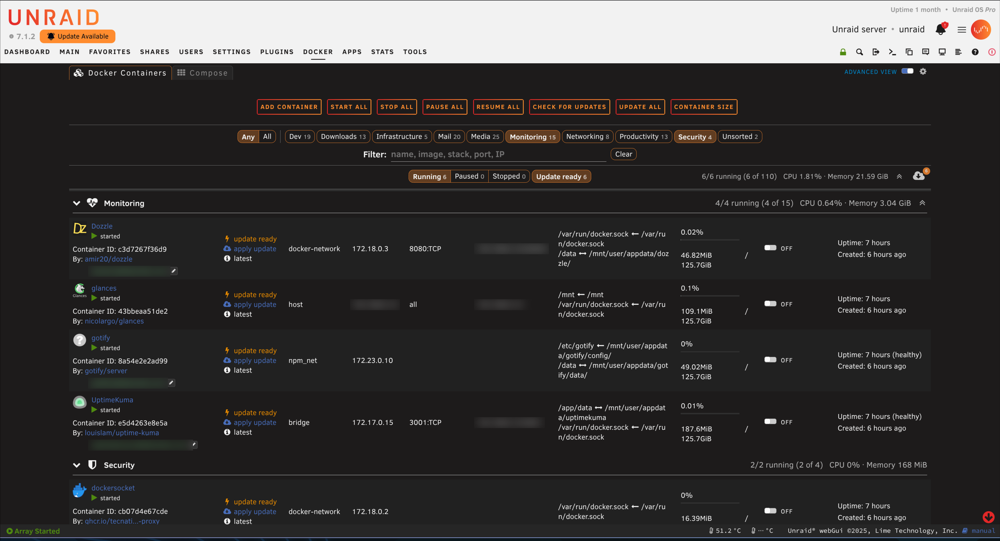
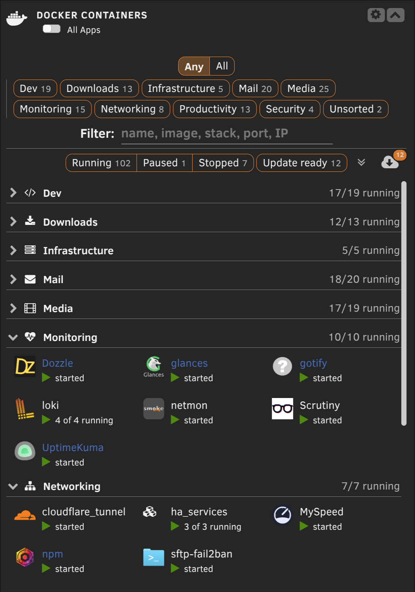

# Container View

> This is a vibe-coded / AI-assisted project, built to scratch my own itch on
> my Unraid box. Sharing it in case it's useful to someone else — no
> guarantees beyond "works on my server."

An Unraid plugin that groups and filters the Docker containers list, and the
Dashboard's Docker tile, by category. There are no folders to maintain: a
container's category comes from a label on the container or from a rule.
Unraid's own container rows are kept exactly as they are, so other plugins
that work on the Docker page keep working.

Requires Unraid 7.0 or later.



## Install

1. In the Unraid web UI, open **Plugins → Install Plugin**.
2. Paste this URL and click **Install**:
   ```
   https://raw.githubusercontent.com/marching-poozer/unraid-port-viewer/main/containerview/containerview.plg
   ```
3. Open the **Docker** tab; the list is now grouped. Settings are in the cog
   beside *Basic / Advanced View*.

Updates appear on the **Plugins** page like any other plugin. To uninstall,
remove it there; your settings and rules stay on the flash.

## Categories

- **Label:** set `net.unraid.docker.category` on a container. Separate
  several categories with commas, e.g. `media,downloads`.
  - In a compose file, add it under the service's `labels:`.
  - For a template container, add a *Label* config with that key.
- **Rules:** for containers you'd rather not relabel, add a rule from the
  container's (or stack's) menu with *Create category rule…*, or from the
  cog's *Category rules…* list.
  - A rule matches on the compose stack, the container name, or the image.
    Use `*` and `?` as wildcards.
  - Containers in a compose stack are covered by stack rules only, so a
    whole stack is categorised together.
- **Which wins:** set by the cog's *Category precedence*. With *Labels win*
  (the default), rules only apply to containers without a label. With
  *Rules win*, a matching rule replaces the label.
- **Where a container appears:** in one group, its first category. Its other
  categories show as tags. Containers with no category go to *Unsorted*.
- **Creating a category:** a category exists as soon as a label or rule
  uses it. Names are case-insensitive, up to 40 characters, and can't
  contain commas.

## Docker tab

- **Groups:** one per category, A→Z, with *Unsorted* last. Each group shows
  its icon, name, "N/M running" and, in Advanced view, CPU and memory.
  - Click a group's icon or name for *Start / Stop / Restart / Pause /
    Resume all*, *Update all* and *Change icon…*.
- **Compose stacks:** shown as one collapsible row with "N of M running".
  The stack's menu has the same actions plus its category rule.
  - *Use icon for stack* in a member container's menu picks the stack's
    icon.
- **Sticky headers:** the current group's header, and an open stack's
  header, stay pinned under the filter bar while their containers scroll
  past.
- **Filter bar** (stays at the top):
  - *Any / All* category chips;
  - a text filter for name, image, stack, category, port or IP (press `/`
    to jump to it);
  - *Running | Paused | Stopped* (one at a time) and *Update ready*;
  - "N/M running", *expand / collapse all*, and an update button.
- **Counts:** every chip's count is how many containers selecting it would
  show.
- **Update button:** its badge counts the containers listed that have an
  update ready. It opens a picker where you untick any to skip. The update
  runs in the background by default.
  - Compose containers are listed but skipped: update their stack instead.
- **Your view is remembered:** which groups and stacks are collapsed, and
  the selected chips, are kept per browser.

## Dashboard tile

The Dashboard's Docker Containers tile is grouped the same way.



- **Sections:** one per category, each with its icon, name and count.
  Click the icon or name for the group menu, and use the chevron or
  *expand / collapse all* to collapse sections.
- **Stacks:** each compose stack shows as a single icon with "N of M
  running" and opens the stack menu.
- **Filters:** the tile has its own filter row, with the same chips, text
  filter and update button as the tab, remembered separately.
- **Scrolling:** the sections scroll inside the tile (up to half the window
  height), with each section's heading pinned while it's in view.
- **Shared with the tab:** collapse state.

## Settings

The cog beside *Basic / Advanced View* on the Docker tab has:

- **Enabled:** turn off to get Unraid's own Docker list and Dashboard tile
  back. Only the cog stays, so you can turn it back on.
- **Unraid buttons:** put *Add Container*, *Start All* and the rest at the
  top (above the filter bar) or at the bottom.
- **Alignment:** left, centred or right, for the filter bar and those
  buttons.
- **Category precedence** and **Category rules…**: see above.

Settings, rules and icon choices are stored on the flash in
`/boot/config/plugins/containerview/` and are kept if the plugin is removed.

## Building a release

`./build.sh <version>` builds the package into `archive/` and stamps
`containerview.plg`. Unraid compares versions as plain text, so keep
same-day suffixes the same width (`.9` is followed by `.91`, not `.10`).
Development notes, the native-parity rule and the tests are in
[CLAUDE.md](CLAUDE.md).

## License

MIT - see [LICENSE](LICENSE).
