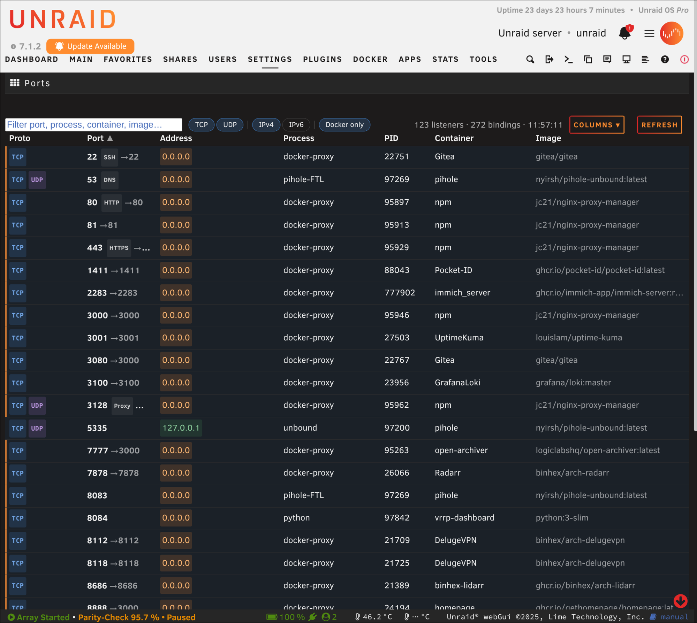

# Unraid Port Viewer

> This is a vibe-coded / AI-assisted project, built to scratch my own itch on
> my Unraid box. Sharing it in case it's useful to someone else — no
> guarantees beyond "works on my server."

A clean, scannable view of every TCP/UDP port your Unraid box is listening on,
with the owning process and Docker container (when applicable) attributed to
each. Lives under **Settings → Network Services**.

Requires Unraid 7.0 or later.



## Highlights

- Covers TCP and UDP, IPv4 and IPv6, and merges a service bound to both
  protocols (e.g. DNS) into a single entry instead of listing it twice.
- Resolves `docker-proxy` host-port mappings back to the owning container,
  including port ranges and host-network containers.
- Flags exposure: distinguishes listeners bound to a wildcard or public
  address from ones only reachable on the LAN, link-local, or localhost.
- Deduplicates identical bindings across interfaces and address families so
  multi-homed daemons (wsdd2, avahi, ...) don't clutter the list.
- Labels well-known ports (SSH, DNS, HTTP/HTTPS, NFS, SMB, MySQL, ...) so you
  don't have to look them up.
- Searchable and filterable by protocol, address family, or Docker-only;
  sortable and customizable columns, with your view preferences remembered
  between visits.
- Pure JS / PHP, no external dependencies.

## Install

1. In the Unraid web UI, open **Plugins → Install Plugin**.
2. Paste this URL and click **Install**:
   ```
   https://raw.githubusercontent.com/marching-poozer/unraid-port-viewer/main/ports/ports.plg
   ```
3. Open **Settings → Network Services → Ports**.

Updates appear on the **Plugins** page like any other plugin.

## License

MIT — see [LICENSE](../LICENSE).
